<p align="center">
  
</p>

<p align="center">
  <strong>A self-hosted security posture dashboard for Microsoft Intune and Microsoft Defender for Endpoint,<br>
  with an optional open endpoint agent for Windows.</strong>
</p>

<p align="center">
  <a href="#getting-started">Getting started</a> ·
  <a href="docs/architecture.md">Architecture</a> ·
  <a href="docs/configuration.md">Configuration</a> ·
  <a href="docs/usage.md">Usage</a> ·
  <a href="CONTRIBUTING.md">Contributing</a> ·
  <a href="SECURITY.md">Security</a>
</p>

---

**Pandore** brings the data an IT security team checks every day — device compliance, Secure
Score, Defender alerts, vulnerabilities, deployed applications — into one fast local dashboard,
so you no longer jump between the Intune admin center, the Defender portal and spreadsheets.

It comes with **Vanitas**, an optional self-hosted endpoint platform (a .NET Windows service and
its server) for the things Microsoft's portals do not give you directly: your own compliance
scripts, remote PowerShell, application pushes, Windows update policies and behavioural
detection on the endpoints you manage.

> [!NOTE]
> **Status:** built and used by one IT department on a real tenant (~1,000 devices). It is
> functional and tested, but it is not a packaged product: expect to read the docs and run a
> few commands. **The user interface is currently in French**; documentation is in English.

## Contents

- [Why Pandore](#why-pandore)
- [Key features](#key-features)
- [How it works](#how-it-works)
- [Screenshots](#screenshots)
- [Technology stack](#technology-stack)
- [Getting started](#getting-started)
- [Configuration](#configuration)
- [Usage](#usage)
- [Project structure](#project-structure)
- [Roadmap](#roadmap)
- [Contributing](#contributing) · [Security](#security-and-privacy) · [License](#license) · [Acknowledgments](#acknowledgments)

## Why Pandore

Microsoft 365 security data is spread across several portals and APIs, and some of the
"obvious" API endpoints return stale or wrong numbers. Pandore exists to give an IT team one
trustworthy view:

- **One place for posture.** Compliance, exposure, alerts and vulnerabilities side by side,
  with drill-down from a fleet-wide number to the exact device and setting.
- **Numbers you can trust.** Compliance is read from Intune's **reporting API** — the source the
  Intune portal itself uses — instead of the legacy per-device endpoints that Microsoft
  deprecated without updating the public documentation (see
  [Microsoft Graph pitfalls](docs/architecture.md#microsoft-graph-pitfalls)).
- **Your data stays local.** The backend runs on your machine (`127.0.0.1` by default) with your
  own app registrations; nothing is sent to a third-party service.
- **Usable by an AI assistant.** The same backend functions are exposed as
  [MCP](https://modelcontextprotocol.io/) servers, so Claude Desktop can answer questions about
  your fleet with the exact same logic as the dashboard.

## Key features

**Pandore — Intune and Defender for Endpoint**

| Area | What you get |
|---|---|
| Dashboard | KPIs (managed devices, compliance rate, Defender exposure score, active alerts), daily history trends, devices at risk, newly enrolled devices, top recommendations. Tiles can be reordered and resized. |
| Devices | Fleet inventory joining Intune, Defender and Vanitas (sources, sensor health, compliance, exposure) and a 360° device page: hardware, OS, identity and network, detected apps, vulnerabilities, per-policy compliance, alerts. |
| Compliance | Per-policy and per-OS non-compliance from Intune reports, prioritised failing policies, per-setting drill-down, 90-day trend. |
| Secure Score | Microsoft Secure Score with industry comparison, devices by exposure level, most vulnerable software, recommendation details. |
| Alerts | Defender alerts by severity, status and classification, detection sources, named threats, column filters. |
| Vulnerabilities | Tenant CVE inventory, CVE watchlist with automatic re-checks, matching of **CERT-FR** advisories against your installed software. |
| Applications | Deployed apps with install status and assignments, a Win32 packaging wizard (`.intunewin` from an MSI or a GitHub release) and an internal app library. |
| Access control | Local accounts (Argon2 hashes), admin and read-only roles, per-module read/write profiles, login throttling. |

**Vanitas — self-hosted endpoint agent (optional)**

| Area | What you get |
|---|---|
| Enrollment | One-time enrollment tokens, per-agent client certificates from a private CA (mTLS), automatic renewal and revocation. |
| Inventory | Installed software, hardware, OS, network; CVE matching against the NVD; end-of-life software. |
| Compliance | Your own PowerShell rules (exit code 0/1) run as SYSTEM, results per device and per rule. |
| Operations | Groups with dynamic rules, application pushes, remote uninstall, agent self-update, Windows update policies (rings, maintenance windows, grace periods). |
| Response | Interactive remote PowerShell terminal, network isolation, Windows event log viewer, full activity log. |
| Detection | Behavioural telemetry from the agent (suspicious processes, Windows event log, outbound connections, USB storage), triaged in the dashboard and correlated with Defender. |

## How it works

<p align="center">
  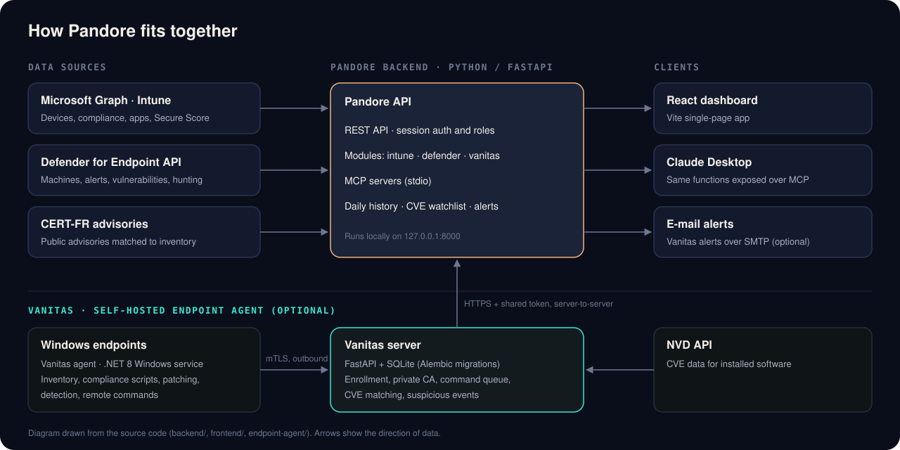
</p>

1. **The Pandore backend** (Python, FastAPI) authenticates to Microsoft Graph and the Defender
   for Endpoint API with your app registrations (MSAL, app-only by default).
2. Each business function (for example `get_compliance_detail` or `list_alerts`) lives in a
   domain module and is reused **unchanged** by two consumers: the REST API used by the
   dashboard, and the MCP servers used by Claude Desktop.
3. **The React dashboard** calls the local REST API. Cheap data is preloaded once; expensive
   views load on demand and are cached.
4. **Vanitas agents** run as a Windows service on each endpoint and always connect *out* to
   the Vanitas server over mutual TLS — no inbound port is opened on endpoints.
5. The browser **never talks to the Vanitas server**: the Pandore backend relays every call
   server-to-server with a shared token, after checking the user's permissions.

The full picture, with data-flow and sequence diagrams, is in
[docs/architecture.md](docs/architecture.md).

## Screenshots

> Captured in [demo mode](docs/demo.md): every device, user and alert below is **fictional**
> (generated data, `DEMO-` device names). The interface is in French.

| Dashboard | Device page (Intune + Defender) |
|---|---|
| 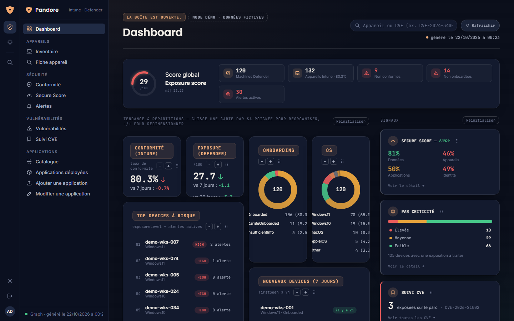 | 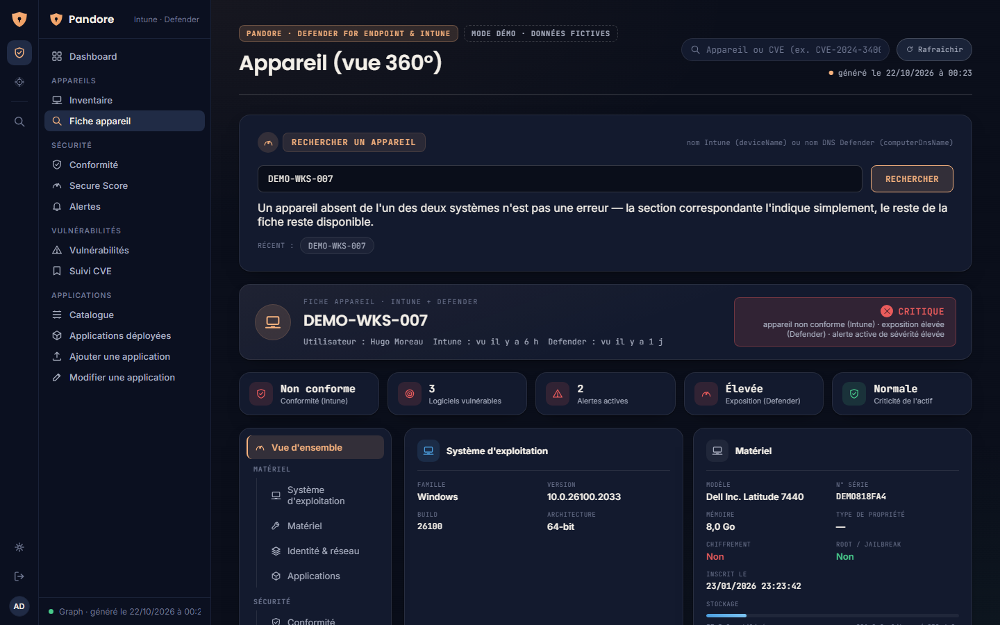 |
| **Compliance** | **Defender alerts** |
| 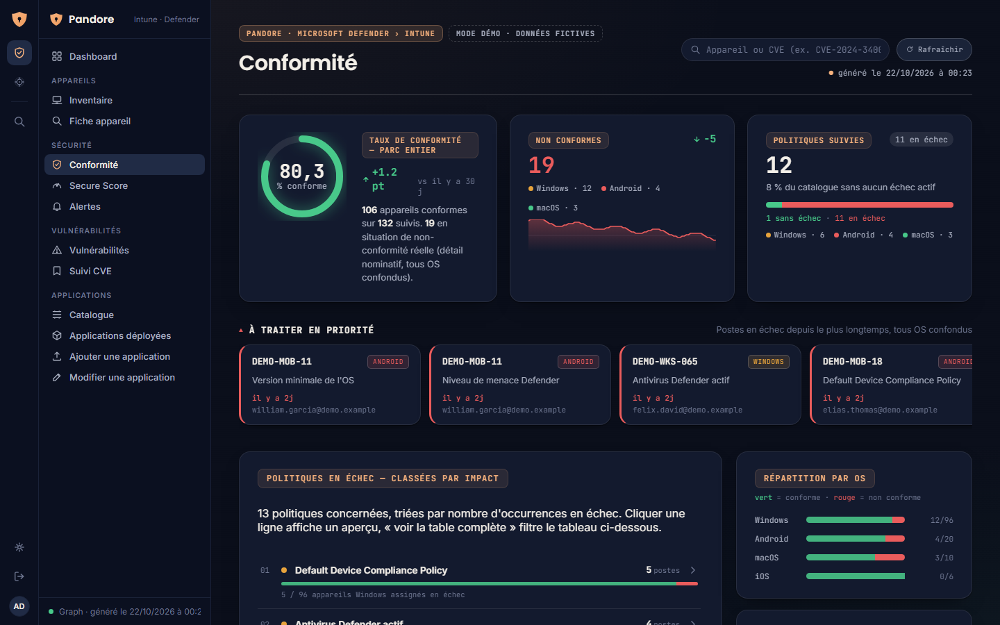 | 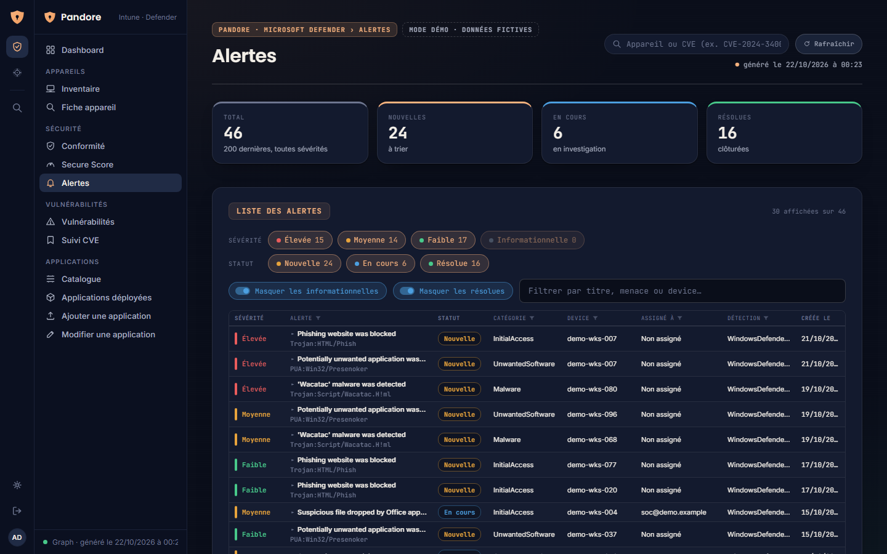 |
| **Vanitas — overview** | **Vanitas — suspicious activity** |
| 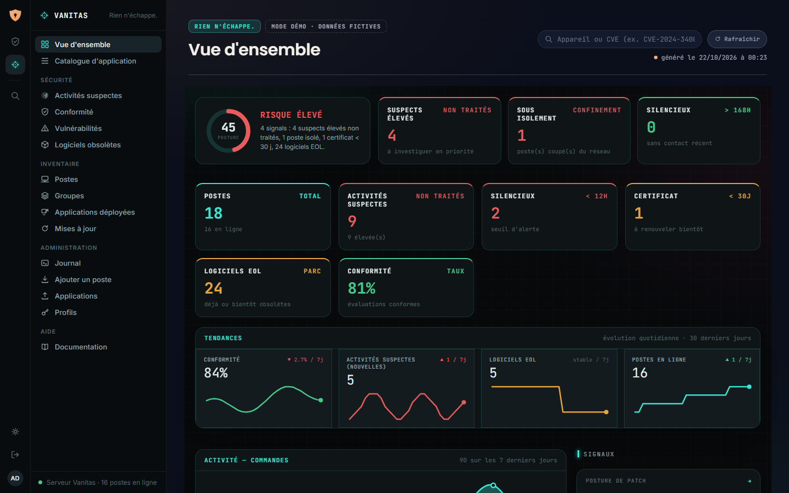 | 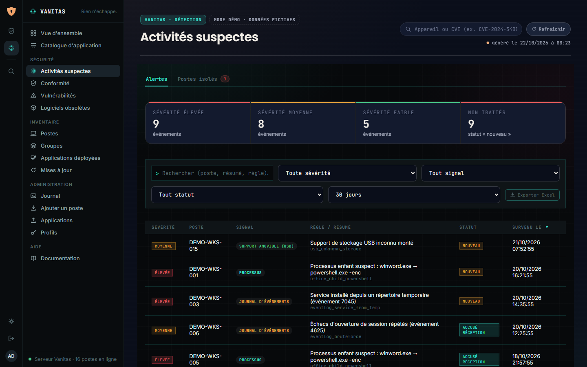 |

<details>
<summary>More screenshots</summary>

| Secure Score | Vulnerabilities |
|---|---|
| 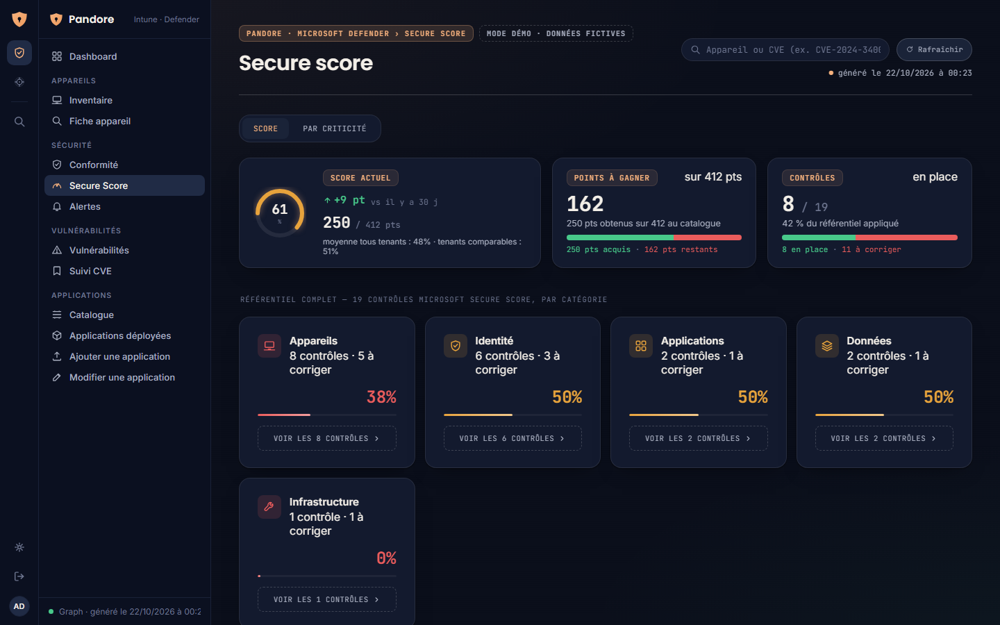 | 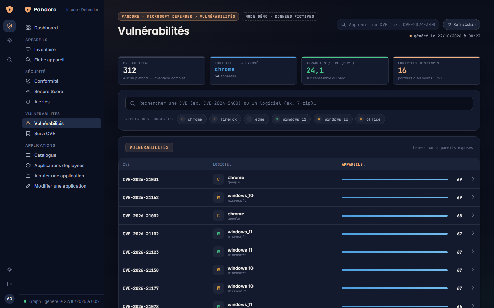 |
| **Vanitas — devices** | **Vanitas — Windows updates** |
| 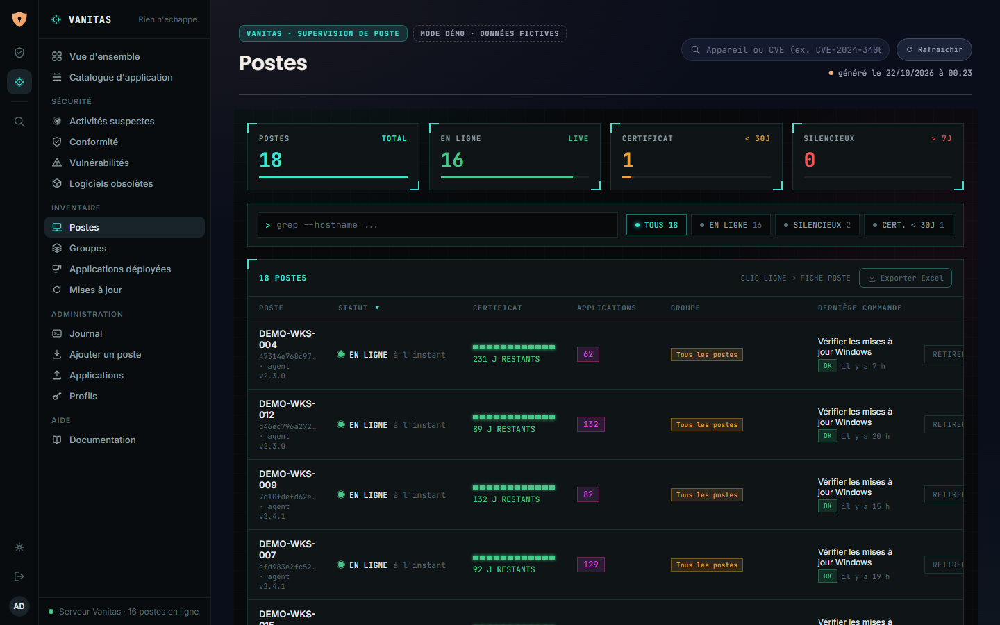 | 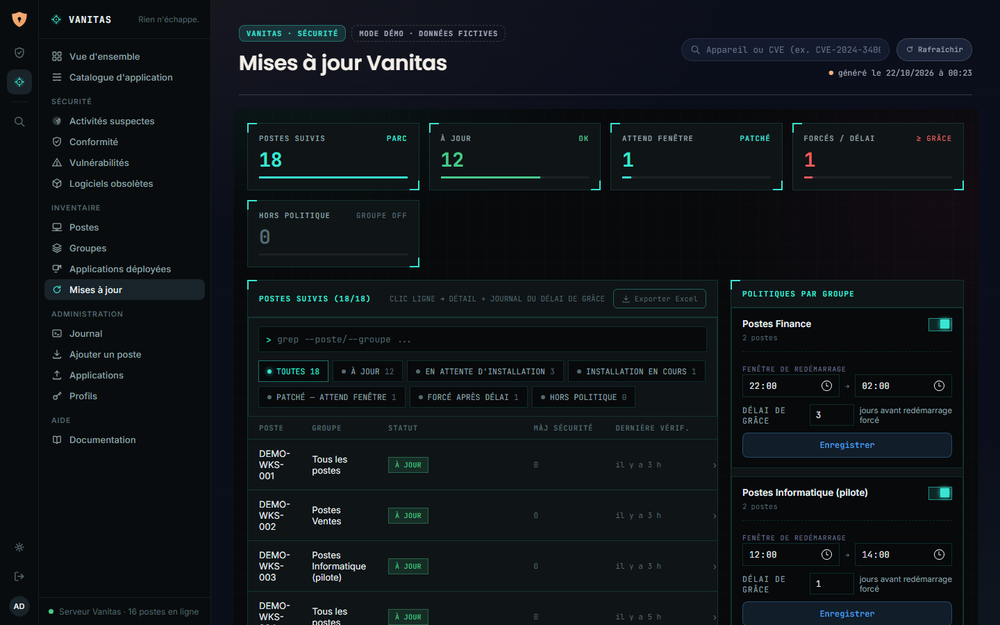 |

</details>

## Technology stack

| Layer | Technology | Why |
|---|---|---|
| Dashboard | React 18, Vite, plain JavaScript and CSS | Fast local development; code-split pages; no UI framework lock-in. |
| Backend | Python, FastAPI, httpx, MSAL | Thin async-friendly API over Microsoft Graph and the Defender API. |
| AI integration | FastMCP | Exposes the same functions to Claude Desktop over stdio. |
| Accounts | Argon2 (`argon2-cffi`), JSON files with atomic writes | Simple, file-based storage for a single-instance tool. |
| Vanitas server | FastAPI, SQLAlchemy, SQLite, Alembic, `cryptography` | Small footprint, versioned schema migrations, private CA for mTLS. |
| Vanitas agent | .NET 8 Worker Service, WiX Toolset 4 (MSI) | Native Windows service, WMI and event log access, silent MSI deployment. |
| Tests | pytest, Vitest, xUnit (agent) | Unit and characterisation tests for each component. |

## Getting started

### Prerequisites

| Component | Requirement |
|---|---|
| Pandore backend | Windows, macOS or Linux · **Python 3.12** (tested; newer releases may lack prebuilt wheels for some dependencies) |
| Dashboard | **Node.js 22 LTS or newer** (tested with 24 LTS) |
| Microsoft 365 | Two Entra ID app registrations (Graph/Intune and Defender for Endpoint) with admin-consented **application** permissions — see [docs/installation.md](docs/installation.md#1-create-the-entra-id-app-registrations) |
| Vanitas (optional) | Python 3.12 for the server · **.NET 8 SDK** on Windows to build the agent and its MSI |

### Try it without a tenant

The [demo mode](docs/demo.md) runs the dashboard with fictional data — no backend, no Microsoft
365 tenant, no secret:

```powershell
cd frontend
npm install
npm run demo                    # http://localhost:5180
```

### Quick start (Pandore only)

The commands below use Windows PowerShell; on macOS or Linux replace
`.\.venv\Scripts\python.exe` with `.venv/bin/python` and `copy` with `cp`.

```powershell
# 1. Backend
cd backend
py -V:3.12 -m venv .venv
.\.venv\Scripts\python.exe -m pip install -r requirements.txt
copy .env.example .env          # then fill in your tenant and app registration values
.\.venv\Scripts\python.exe manage_users.py create alice admin   # prompts for a password
.\.venv\Scripts\python.exe api_server.py                         # http://127.0.0.1:8000
```

```powershell
# 2. Dashboard (in a second terminal)
cd frontend
npm install
npm run dev                     # http://localhost:5173
```

Open <http://localhost:5173> and sign in with the account you created.

> [!TIP]
> If PowerShell refuses to run `npm` or `npx` ("running scripts is disabled on this system"),
> call `npm.cmd` / `npx.cmd` instead, or adjust your execution policy.

To add **Vanitas** (server, CA, agent MSI and enrollment), follow
[docs/installation.md](docs/installation.md#4-optional-set-up-vanitas).

## Configuration

All configuration is done through environment files that are **never committed**:

| File | Purpose | Template |
|---|---|---|
| `backend/.env` | Microsoft credentials, Vanitas link, SMTP alerts, job intervals | [`backend/.env.example`](backend/.env.example) |
| `endpoint-agent/server/.env` | CA passphrase, shared dashboard token, NVD API key | [`endpoint-agent/server/.env.example`](endpoint-agent/server/.env.example) |

The minimum for the dashboard is the six Microsoft values (`MDE_*` and `AZURE_*`). Every
variable, its default and its effect is listed in [docs/configuration.md](docs/configuration.md).

## Usage

- **Daily check:** open the dashboard; the KPIs and "to do" tiles link straight to the
  underlying page (compliance, alerts, vulnerabilities).
- **Investigate a device:** type its name (or a CVE ID) in the global search — `Ctrl K` focuses
  it — to open the 360° device page.
- **Fix compliance:** on the Compliance page, open a failing policy, then a device, to see the
  exact failing setting.
- **Ask Claude:** register the MCP servers in Claude Desktop (example config in
  [`backend/claude_mcp_config.example.json`](backend/claude_mcp_config.example.json)) and ask,
  for example, *"Which devices fail the BitLocker policy?"*

A page-by-page tour and MCP setup are in [docs/usage.md](docs/usage.md).


## Project structure

```text
.
├── backend/                 Pandore API (FastAPI) and MCP servers
│   ├── api_server.py        App setup, middleware, background jobs
│   ├── routers/             REST routes by domain (auth, intune, defender, vanitas)
│   ├── intune/              Microsoft Graph / Intune functions (+ MCP server)
│   ├── defender/            Defender for Endpoint functions, CERT-FR matching (+ MCP server)
│   ├── vanitas/             Server-to-server client for the Vanitas server
│   ├── auth/                Accounts, sessions, roles, login throttling
│   ├── common/              HTTP client, config, caches, history, atomic file I/O
│   ├── manage_users.py      Offline account management CLI
│   └── tests/               pytest suite
├── frontend/                React dashboard (Vite)
│   └── src/                 pages/, components/, hooks/, styles.css, theme.js
├── endpoint-agent/          Vanitas
│   ├── server/              FastAPI server, SQLite models, Alembic migrations, scripts/
│   └── agent/               .NET 8 Windows service, WiX installer, xUnit tests
├── Design/                  Brand guidelines and logos (Pandore & Vanitas)
└── docs/                    Documentation and diagrams
```

A longer description of each component is in [docs/architecture.md](docs/architecture.md).

## Roadmap

These are ideas, **not existing features**:

- English user interface (the UI text is currently French).
- A hosted public demo (the static `npm run build:demo` output) on GitHub Pages.
- Continuous integration for the .NET agent and the MSI build.
- Packaging that simplifies first-time setup (for example a single launcher script).

## Contributing

Contributions are welcome — bug reports, documentation and code. Please read
[CONTRIBUTING.md](CONTRIBUTING.md) for the development setup, test commands and conventions,
and follow the [Code of Conduct](CODE_OF_CONDUCT.md).

## Security and privacy

- Secrets live only in git-ignored `.env` files; templates contain placeholders only.
- The backend listens on `127.0.0.1` by default and requires a session for every route except
  login and health. Vanitas agents authenticate with per-device certificates (mTLS).
- Vanitas can run commands **as SYSTEM** on endpoints (scripts, installs, remote shell): protect
  the server, its CA passphrase and the shared token accordingly.

Please report vulnerabilities privately as described in [SECURITY.md](SECURITY.md).

## License

Released under the [MIT License](LICENSE).

## Acknowledgments

- Built on [FastAPI](https://fastapi.tiangolo.com/), [React](https://react.dev/),
  [Vite](https://vite.dev/), [MSAL for Python](https://github.com/AzureAD/microsoft-authentication-library-for-python),
  [FastMCP](https://github.com/jlowin/fastmcp), [SQLAlchemy](https://www.sqlalchemy.org/),
  [Alembic](https://alembic.sqlalchemy.org/), [WiX Toolset](https://wixtoolset.org/) and
  [.NET](https://dotnet.microsoft.com/).
- Vulnerability data from the [NVD](https://nvd.nist.gov/) and security advisories from
  [CERT-FR](https://www.cert.ssi.gouv.fr/). This product uses the NVD API but is not endorsed or
  certified by the NVD.
- End-of-life dates from [endoflife.date](https://endoflife.date/); Android app names resolved
  from public Google Play pages; installers fetched from the GitHub Releases API.
- Fonts in the brand guidelines: Inter, Poppins and JetBrains Mono (SIL Open Font License).
- Microsoft, Intune, Defender and Entra are trademarks of Microsoft Corporation; this project is
  not affiliated with or endorsed by Microsoft.
