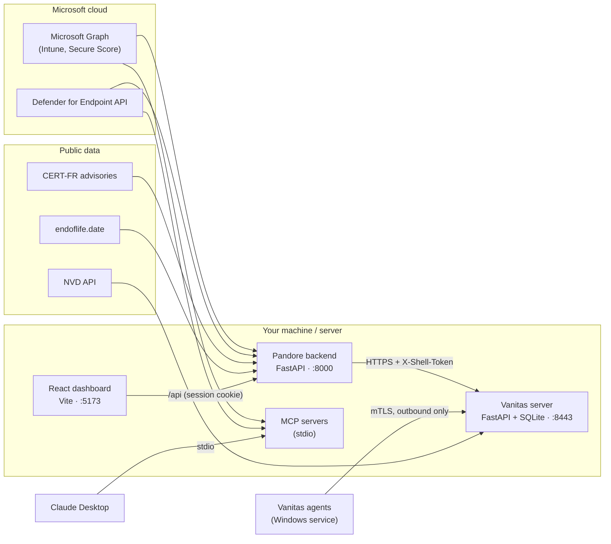
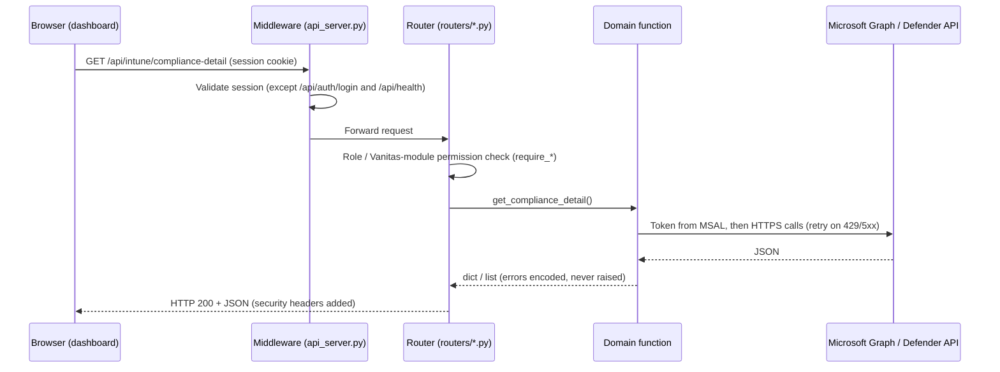
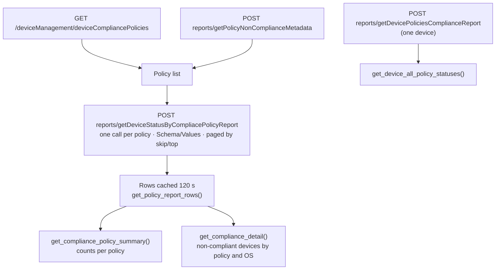
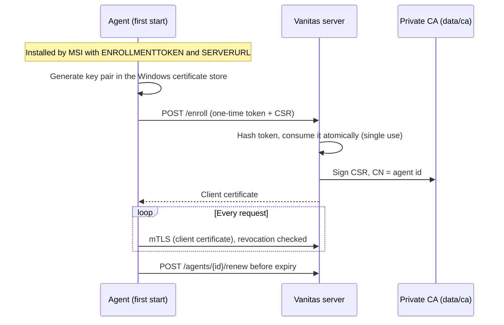
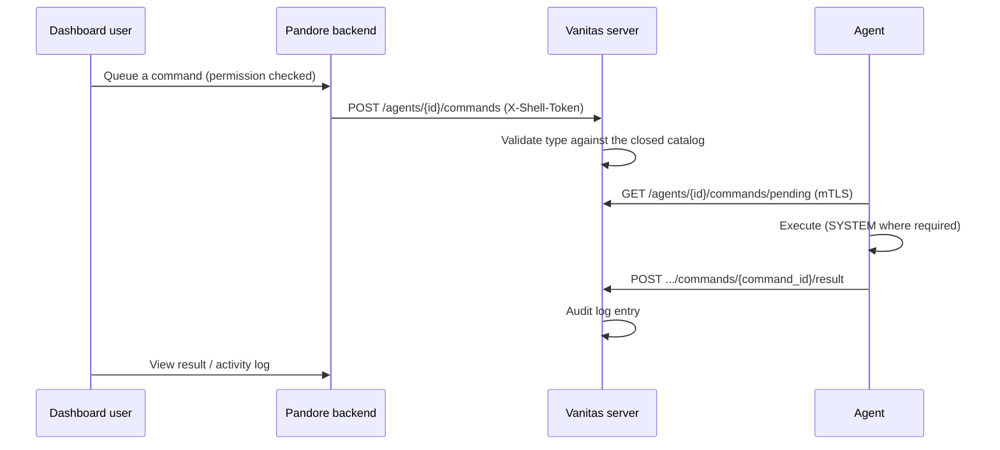
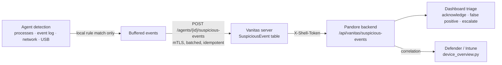

# Architecture

This page explains how Pandore and Vanitas are built and how data moves between them. It is
written from the source code; file paths are given so you can check every statement.

- [Components](#components)
- [Pandore backend](#pandore-backend)
- [Dashboard (frontend)](#dashboard-frontend)
- [Vanitas](#vanitas)
- [Security model](#security-model)
- [Data storage](#data-storage)
- [Background jobs](#background-jobs)
- [Microsoft Graph pitfalls](#microsoft-graph-pitfalls)
- [Design system](#design-system)

## Components

| Component | Location | Role |
|---|---|---|
| Pandore backend | `backend/api_server.py`, `backend/routers/` | REST API on `127.0.0.1:8000` (infrastructure in `api_server.py`, routes split by domain in `routers/`) |
| Domain modules | `backend/intune/`, `backend/defender/`, `backend/vanitas/`, `backend/device_overview.py` | "Bare" business functions decorated with `@handle_tool_errors` |
| MCP servers | `backend/intune/mcp_server.py`, `backend/defender/mcp_server.py` | The same functions exposed to Claude Desktop over stdio |
| Dashboard | `frontend/src/` | React single-page app, served by Vite in development |
| Vanitas server | `endpoint-agent/server/app/` | Enrollment, mTLS agent routes, dashboard routes (port 8443) |
| Vanitas agent | `endpoint-agent/agent/EndpointAgent/` | .NET 8 Windows service: collection, command execution, detection |
| Agent installer | `endpoint-agent/agent/Installer/` | WiX 4 MSI that installs and registers the service |

## Pandore backend

### One function, two consumers

Business functions (for example `intune.compliance.get_compliance_policy_summary`) are written
once and reused without modification by:

1. **the REST API** — one route per function in `backend/routers/<domain>.py`;
2. **the MCP servers** — each exposed function is listed in `_TOOLS` of the domain's
   `mcp_server.py`. `backend/tests/test_mcp_tool_parity.py` fails if a public function is neither
   registered nor explicitly excluded in `EXCLUDED_FROM_MCP`.

### Request lifecycle

**Error contract.** `@handle_tool_errors` (`backend/common/http_client.py`) turns an exception
into `{"error": true, "type", "message"}` for functions returning a `dict`, or into a one-item
list for functions returning `list[dict]`. Business errors therefore arrive with **HTTP 200**;
the frontend checks them with `isErrorPayload` / `listPayloadError`. `RuntimeError` is reserved
for MSAL authentication failures.

### Compliance data flow

Compliance is read exclusively from Intune's **reporting API** (`backend/intune/compliance.py`):

The metadata report is the only source that lists the built-in "Default Device Compliance
Policy". The per-setting drill-down of one device and policy uses the
`managedDevices/{id}/deviceCompliancePolicyStates/{policyId}/settingStates` navigation.

## Dashboard (frontend)

- **Plain React + Vite, no TypeScript, no UI library.** Styles live in `frontend/src/styles.css`
  and design tokens in `frontend/src/theme.js`.
- **Shell:** `pages/Dashboard.jsx` renders the sidebar (`components/Sidebar.jsx`, a rail of
  "worlds" — Pandore and Vanitas — plus a navigation column) and the active page.
- **Code splitting:** every page is loaded with `React.lazy`, so the first load only contains
  the shell and the opened page.
- **Data loading:** `hooks/dashboardData.js` preloads cheap data for every page; expensive data
  (compliance detail, Secure Score, per-device views) has its own on-demand hook. Results are
  kept in a shared cache (`cache.js`, 2-hour TTL) that survives page changes.
- **Development proxy:** `vite.config.js` proxies `/api` to `http://localhost:8000`.

## Vanitas

Vanitas is an optional endpoint platform. **The browser never talks to the Vanitas server**:
every call goes through the Pandore backend (`backend/vanitas/client.py`), which checks the
user's permissions and attaches the shared `X-Shell-Token`.

### Enrollment and identity

The private key never leaves the endpoint. Enrollment tokens are stored only as SHA-256
hashes. Revoked certificates are kept in a separate table that outlives agent deletion.

### Commands

The agent **polls** the server; no inbound port is opened on endpoints.

The command catalog is closed (`endpoint-agent/server/app/commands.py`): inventory refresh,
service restart, diagnostics, Windows update check, hardware inventory, uninstall, remote
shell session, compliance check, application install and others defined there. Installers and
scripts are verified by SHA-256 before execution, inside a working directory under
`%ProgramData%` with a hardened ACL.

### Suspicious activity detection

Only events matching a rule leave the endpoint. A unique constraint on
`(agent_id, local_event_id)` makes uploads idempotent after a network retry.

## Security model

| Concern | Implementation |
|---|---|
| Pandore sign-in | Local accounts, Argon2 hashes (`backend/auth/`), session cookie `httponly` / `samesite=lax` (`Secure` when `SESSION_COOKIE_SECURE=true`) |
| Brute force | 10 failed logins in 5 minutes from one IP lock that IP for 5 minutes (HTTP 429); Argon2 always runs to avoid timing leaks |
| Authorization | Roles `admin` / `viewer`; viewers get per-module read/write rights through Vanitas profiles; enforced server-side by `require_admin`, `require_vanitas_read`, `require_vanitas_write` |
| HTTP headers | `X-Content-Type-Options: nosniff`, `X-Frame-Options: DENY`, `Referrer-Policy: no-referrer` on every response |
| Graph input | IDs validated before being used in URLs (`validate_graph_id`); OData and KQL strings escaped |
| Vanitas agents | mTLS with a private CA, revocation list, server certificate validated by the agent (chain, EKU and host name) |
| Vanitas dashboard routes | Shared secret `X-Shell-Token`, constant-time comparison, deny by default when unset |
| Secrets | Only in git-ignored `.env` files |

## Data storage

| Data | Where | Notes |
|---|---|---|
| Accounts and sessions | `backend/data/auth_users.json`, `auth_sessions.json` | Git-ignored; atomic writes and a lock |
| Daily metrics history | `backend/data/history.json` | 90-day retention |
| Watched CVEs, app library | `backend/data/watched_cves.json`, `app_library.json` | Created on first write |
| Vanitas profiles | `backend/data/vanitas_profiles.json` | Per-instance configuration |
| Vanitas fleet | `endpoint-agent/server/data/endpoint_agent.db` | SQLite; schema managed by **Alembic** (`alembic upgrade head` at startup) |
| Vanitas CA | `endpoint-agent/server/data/ca/` | `ca-key.pem` encrypted with `CA_KEY_PASSPHRASE` |

## Background jobs

Started with the Pandore backend (`backend/api_server.py`):

| Job | Default interval | Purpose |
|---|---|---|
| `_history_snapshot_loop` | 1 h check | Records one Intune / Defender / Vanitas metrics point per day; retries a partial point |
| `_watchlist_refresh_loop` | 1 h | Re-checks watched CVEs |
| `_vanitas_agent_health_loop` | 1 h | Silent agents and expiring agent certificates → e-mail alert on the transition only |
| `_vanitas_diff_alert_loop` | 1 h | New critical vulnerability, new compliance failure or new end-of-life software per agent → e-mail alert |
| `_vanitas_purge_loop` | 24 h | Deletes Vanitas history older than the retention period |

The Vanitas server refreshes CVE matches against the NVD every `CVE_REFRESH_INTERVAL_HOURS`.

## Microsoft Graph pitfalls

Lessons learned on a production tenant, applied throughout the code:

- **`$select` is validated against the declared type of the collection.** A property that only
  exists on a subtype makes the whole request fail with HTTP 400. For beta-only properties,
  call `client_beta` without `$select`.
- **Several per-device Intune endpoints were deprecated in May 2023 without the public
  documentation being updated** (`deviceStatuses`, `managedDeviceMobileAppInstallStatuses`,
  `mobileAppInstallSummary`, the `deviceCompliancePolicyStates` list). They return HTTP 400 or
  truncated lists. The aggregate `deviceStatusOverview` still answers, but its counts differed
  from the Intune portal on 19 of 34 policies when measured.
  Prefer the reporting endpoints `POST /deviceManagement/reports/...`, whose answer is a table
  (`Schema` + positional `Values` + `TotalRowCount`, paged with `skip` / `top`). Some report
  names contain Microsoft typos, such as `getDeviceStatusByCompliacePolicyReport`.
- **`InstallState` is an integer** enumeration code, not a string.
- **Missing permission vs. bug:** an endpoint never used before may fail because of a missing
  application permission rather than a code error.

## Design system

The visual identity (two "worlds": Pandore in amber on deep navy, Vanitas in cyan on near
black) is documented in `Design/charte-graphique-pandore-vanitas.html` (French). Severity and
status colours are shared by both worlds and never derived from the brand accent.
