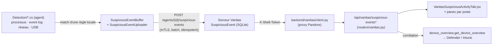

# Pandore / Vanitas — référence d'architecture

Référence **durable** du projet, organisée par thème (pas par chronologie). Le journal
chronologique complet, session par session, est dans [`docs/internal/HISTORY.md`](HISTORY.md) — à
consulter pour le « pourquoi » détaillé d'une décision, un incident passé, ou le contexte d'une
fonctionnalité précise. Ce fichier-ci résume ce qu'il faut savoir AVANT de coder.

---

## 1. Vue d'ensemble

Dashboard de sécurité **interne** (DSI) réunissant deux produits sous une même UI :

- **Pandore** — le dashboard lui-même : consomme Microsoft Graph (Intune / Endpoint Manager) et
  Microsoft Defender for Endpoint (MDE). Frontend React (function components + hooks, **Vite, PAS
  de TypeScript**) + backend FastAPI/Python.
- **Vanitas** — plateforme d'agent d'endpoint maison (dossier `endpoint-agent/`, projet séparé
  avec son propre README) : un agent .NET (Windows Service) qui s'enrôle en mTLS auprès d'un
  serveur FastAPI + SQLAlchemy/SQLite. Nommé « Vanitas » côté dashboard pour ne pas se confondre
  avec « Pandore » (le nom/la marque du dashboard). Pandore ne parle JAMAIS directement au serveur
  Vanitas depuis le navigateur : tout passe par un relais serveur-à-serveur
  (`backend/vanitas/client.py`).

### Cartographie des composants

| Composant | Emplacement | Rôle |
|---|---|---|
| Backend Pandore | `backend/api_server.py` (infra) + `backend/routers/*` (routes) | API REST JSON (127.0.0.1:8000) |
| Modules métier | `backend/{intune,defender,vanitas,device_overview,auth,common}/` | Fonctions « nues » décorées `@handle_tool_errors` |
| Frontend | `frontend/src/` (Vite/React) | Dashboard, servi par Vite en dev (5173) |
| Serveur MCP | `backend/intune/mcp_server.py`, `backend/defender/mcp_server.py` | Mêmes fonctions exposées à Claude Desktop (stdio) |
| Serveur Vanitas | `endpoint-agent/server/app/` (FastAPI + SQLAlchemy) | mTLS agents + routes dashboard (8443) |
| Agent Vanitas | `endpoint-agent/agent/EndpointAgent/` (.NET) | Windows Service, dispatch de commandes + `Detection/` (télémétrie comportementale, 2026-09-14) |

### Backend Pandore — deux consommateurs, une source

Les fonctions métier (`list_apps`, `get_compliance_detail`…) vivent dans des modules par domaine
et sont réutilisées SANS modification par :
1. `mcp_server.py` (MCP stdio, Claude Desktop) — chaque fonction exposée doit être ajoutée à la
   liste `_TOOLS`, sinon `tests/test_mcp_tool_parity.py` le signale.
2. la couche HTTP REST (frontend) — une route par fonction, voir ci-dessous.

Modules NON exposés en MCP (hors parité, pas des lectures) : `intune/packaging.py`,
`intune/app_library.py` (partiellement), `vanitas/*`, `device_overview.py`.

### Backend Pandore — couche HTTP (routers par domaine, 2026-09-12)

`api_server.py` (~495 l.) ne contient QUE l'infrastructure : instance `FastAPI`, middlewares
(auth de session, CORS, en-têtes de sécurité), `lifespan` + boucles de fond, `/api/health`,
les `app.include_router(...)`, et le `uvicorn.run` du `__main__`. **Aucune route métier ici.**
Les 128 routes sont réparties par domaine dans `backend/routers/` :

| Router | Chemins servis |
|---|---|
| `routers/auth.py` | `/api/auth/*` (login/logout/me/users) + `/api/vanitas/profiles/*` (admin) |
| `routers/defender.py` | `/api/defender/*` + `/api/vanitas/cve-avis/{cve_id}` (module `defender/anssi.py`) |
| `routers/intune.py` | `/api/intune/*` (devices, conformité, apps, packaging, bibliothèque, secure score) + transverse `/api/history`, `/api/device-overview`, `/api/device-inventory` |
| `routers/vanitas.py` | tout `/api/vanitas/*` (agents, commandes, terminal, conformité, EOL, alertes, groupes, installeurs, paquets agent, source GitHub, journal d'activité, activités suspectes) — proxy vers `vanitas/client.py` |

Chaque router expose un `router = APIRouter()` **sans `prefix` ni `tags`** (chemins complets
explicites) — condition pour que le schéma OpenAPI reste identique à l'ancienne forme `@app.*`.
Les modèles Pydantic de corps de requête vivent dans le router qui les utilise.

`backend/api_common.py` porte les symboles partagés entre `api_server.py` (middleware, boucles)
et les routers, pour éviter un import circulaire (un router ne peut pas importer `api_server`,
qui l'inclut) : `IdPath`/`_ID_PATTERN`, `SESSION_COOKIE_NAME`, `VANITAS_ALERT_STALE_HOURS`.

**Ajouter une route** : la mettre dans le router de son domaine (importer `IdPath` depuis
`api_common`, le tool métier depuis son module, `require_*` depuis `auth`). Un nouveau domaine =
un nouveau `routers/<x>.py` + un `app.include_router(...)` dans `api_server.py`. Ne jamais
rajouter de `@app.get/post/...` directement dans `api_server.py`.

### Détection d'activités suspectes (Vanitas, 2026-09-14)

Télémétrie comportementale native côté agent — PAS une dépendance à Defender pour la détection
elle-même (Defender reste consommé en lecture seule pour la corrélation, voir plus bas). 4
signaux : processus suspects, journal d'événements Windows, connexions réseau sortantes, support
amovible USB.



- **Filtrage local** : l'agent n'envoie que les événements qui matchent déjà une règle (jamais de
  firehose) — volume proche de l'existant (SQLite, « quelques postes »).
- **Idempotence** : contrainte unique `(agent_id, local_event_id)` sur `SuspiciousEvent`
  (`endpoint-agent/server/app/models.py`) — un replay du même lot après un timeout réseau ne
  duplique rien.
- **`SuspiciousEvent`** : pas de `ForeignKey` vers `Agent` (même motif que `ShellSession`, survit à
  `DELETE /agents/{id}`), **exclu de la purge 90 jours** (`routes/maintenance.py`).
- **Permission Vanitas** : nouveau module `"activites_suspectes"` (lecture large, écriture = triage
  accusé réception/faux positif/escaladé) — 3 fichiers à tenir synchronisés :
  `backend/auth/vanitas_profiles.py` (`MODULES`), `frontend/src/pages/vanitasShared.jsx`
  (`VANITAS_MODULES`), `VanitasProfilesTab.jsx`.
- **Corrélation Defender** : réutilise `backend/device_overview.py::get_device_overview` (jointure
  hostname/AAD device ID déjà existante) — pas de nouvelle fonction de mapping.
- **UI** : onglet transverse dans la nav Vanitas (groupe Sécurité, au-dessus de « Conformité ») +
  pane par poste (`VanitasDeviceDetail.jsx`) + pane « Alertes » enrichi côté Pandore
  (`DeviceOverviewTab.jsx`).

---

## 2. Conventions de code (à respecter pour toute nouvelle fonctionnalité)

### Backend

- **`@handle_tool_errors`** (`common/http_client.py`) encode les exceptions en :
  - `{"error": True, "type", "message"}` pour les fonctions annotées `-> dict`,
  - `[error]` (liste à 1 élément) pour les fonctions annotées `-> list[dict]` (détection via
    `typing.get_type_hints`).
- **⚠️ `RuntimeError` est RÉSERVÉ aux échecs d'auth MSAL** (`common/auth.py::get_token`,
  étiquette `"AuthError"`). Tout nouveau code qui lève une exception volontaire doit utiliser
  `ValueError` etc., JAMAIS `RuntimeError` (sinon une erreur métier remonte comme un faux problème
  d'auth Graph).
- **Client Graph** (`intune/client.py`) : deux instances, `client` (v1.0) et `client_beta`.
  Beaucoup d'endpoints utiles ne sont qu'en `/beta` — vérifier avant d'implémenter en v1.0 par
  réflexe.
- **Validation d'ID dans une URL** : `validate_graph_id` / `GRAPH_ID_PATTERN`
  (`common/http_client.py`), et `IdPath(...)` côté routes FastAPI — jamais interpoler un ID brut
  reçu de l'extérieur dans un chemin/une requête sans validation de format.
- **Échappement KQL / OData** : `_escape_kql_string` / `escape_odata_string` sur toute entrée
  utilisateur injectée dans une requête Advanced Hunting ou un `$filter`.
- **Contrat d'erreur en HTTP 200** : une erreur métier arrive en **200** avec un corps
  `{error:true}`/`[error]`, pas un statut HTTP d'erreur. `postJSON`/`getJSON` ne lèvent que sur un
  vrai non-2xx — donc tout appelant frontend doit vérifier `isErrorPayload`/`listPayloadError`.
- **Persistance JSON faite main** (`backend/data/*.json`) : verrou `threading.Lock` + écriture
  atomique (`common/atomic_io.atomic_write_text`), rechargement basé sur `mtime` pour rester
  correct entre processus (`api_server.py` vs `manage_users.py`). **Ne PAS faire grossir** cette
  approche pour du relationnel — le relationnel va côté SQLite (comme Vanitas).

### Frontend

- **Chargement paresseux des données coûteuses.** `useDashboardData()` précharge les données bon
  marché de tous les onglets (chacune avec son `.catch()`). Toute donnée coûteuse (appels
  séquentiels, par device/politique) va dans son propre hook à la demande (`useComplianceDetail`,
  `useSecureScore`…), JAMAIS dans `useDashboardData` (pénaliserait le 1er rendu de tous les onglets).
- **Hooks de données** : découpés par domaine dans `frontend/src/hooks/` (`shared.js`,
  `dashboardData.js`, `vulnerabilities.js`, `apps.js`, `vanitas.js`), re-exportés par le barrel
  `useDashboardData.js` — importer depuis ce barrel comme avant.
  - `useKeyedFetch(fetchFn, toError, emptyValue, cacheNamespace)` — cache générique par clé (charge
    au 1er accès, mémorise, ne relance jamais un fetch en cours/terminé). Réutiliser, pas réinventer.
  - Deux détecteurs d'erreur : `isErrorPayload` (`-> dict`) vs `listPayloadError` (`-> list[dict]`).
    Se tromper = une erreur s'affiche comme une fausse donnée.
- **Cache partagé** `frontend/src/cache.js` (`cachedCall`, TTL 2h) : survit aux démontages
  d'onglet (contrairement à un `useState`). Invalider explicitement (`invalidateCache`) sur erreur
  métier (elle arrive en 200, `cachedCall` ne la détecte pas seul).
- **Code-splitting** : les pages d'onglet sont chargées en `React.lazy` dans `Dashboard.jsx`
  (rendu enveloppé dans `<Suspense>`) — le bundle initial ne contient que la coquille + la page
  ouverte. Ajouter une page = un `const X = lazy(() => import(...))` + entrée dans `TABS`/`VANITAS_TABS`.
- **Classes CSS dédiées par feature**, même à mécanisme identique — ne pas coupler deux pages non
  liées. Génériques réutilisables : `.cve-table-wrap`/`.cve-device-table`/`.cve-cell-name`/
  `.cve-mono`/`.cve-small`, `.vuln-meta-*`, `.empty`, `.error-note`, `.card`/`.card-head`/
  `.card-note`, `.strip`/`.strip-item` (via `SummaryCard.jsx`).
- **⚠️ Avant d'ajouter une règle CSS en fin de `styles.css` (16000+ lignes), grep le sélecteur
  d'abord** — une classe générique redéfinie plus bas écrase TOUTES les pages (cascade, spécificité
  égale). Pour surcharger dans un seul contexte, scoper (`.wizard-shell .filter-input { … }`).
- **`NAV_TREE`** (structure sidebar) vit dans `components/Sidebar.jsx` (Pandore) /
  `components/VanitasSidebar.jsx` (Vanitas), PAS dans `navigation.js` (qui n'a que
  `resolveSearchTab`/`bumpSearchNav`/`bumpVanitasNav`).
- **Langue de l'interface (FR/EN, 2026-10-22)** : `frontend/src/i18n/` — dictionnaires plats
  `fr.js` (référence) / `en.js`, `core.js` (fonctions pures `translate`, `formatStamp`,
  `LANGUAGES`), `I18nContext.jsx` (`useI18n()` → `{ lang, locale, setLang, t }`, choix gardé en
  `localStorage` `pandore.lang` + reflété sur `<html lang>`). Tout NOUVEAU texte affiché passe par
  `t("clé")` avec la clé ajoutée dans LES DEUX dictionnaires (`i18n.test.js` échoue sinon) ;
  pluriels via `<clé>.one`/`<clé>.other` + `{count}` ; dates/nombres via `locale` (`Intl`), jamais
  `"fr-FR"` en dur. Libellés de nav = `nav.item.<key>` / `nav.group.<group>` (plus de `label` dans
  `NAV_TREE`/`VANITAS_NAV`). Sélecteur = bouton globe du rail (`LanguageMenu`, Sidebar.jsx).
  **Hors composants de coquille** : `tr(key, vars)` (langue courante, `core.js`) — utilisable
  partout dans le contenu des pages car `<main key={lang}>` (Dashboard.jsx) REMONTE le contenu au
  changement de langue (pas de libellé figé dans un `useMemo`). Tables de libellés :
  `localizedTable(prefix, keys)` (valeur lue dans la langue courante, ex. `COMPLIANCE_LABEL`,
  `EXPOSURE_LEVEL_LABEL` — plus de suffixe `_FR`). Constantes de module (`FILTERS = [{label}]`) :
  `get label() { return tr(...) }` ou stocker la clé et appeler `tr()` au rendu. Phrases avec
  balisage : `trRich(key, { n: <strong>{n}</strong> })` (`i18n/rich.jsx`). Les catégories internes
  ("Non conforme", "Erreur"… de `SEVERITY`/`FAILING_CATEGORIES`) RESTENT des identifiants en
  français : traduire à l'affichage via `categoryLabel()` (theme.js). Dictionnaires par zone dans
  `i18n/messages/<zone>.js` (`{ fr, en }` côte à côte), listés par `messages/index.js`.
  Tri dans Vanitas : TOUJOURS `components/SortMenu.jsx` (bouton « Trié par » + menu, critères
  `{ value, label, hint, dir }` où `dir` = ordre naturel du critère ; la page garde son comparateur
  « naturel » et l'inverse si le sens choisi diffère) — jamais un `<select>` natif.
  Documentation Vanitas : contenu en DONNÉES, un fichier par langue (`vanitasDocsContent.fr.js` /
  `.en.js`, choisi par `getLang()`, mêmes `id` et même nombre de repères `legend` des deux côtés)
  — sert la recherche plein texte et l'affichage section par section. Rendu (mise en forme
  `**gras**`/`` `code` ``, blocs, schémas numérotés) dans `vanitasDocsParts.jsx`. Toute
  modification du texte se fait dans LES DEUX fichiers ; une page Vanitas refaite ⇒ sa section.
  Traduit à ce jour : coquille + toutes les pages Pandore et Vanitas + doc Vanitas + exports
  Excel ; reste : messages d'erreur du backend, données démo.
- **Vues d'ensemble réordonnables** : Pandore (`OverviewTab.jsx`, `.ov2-*`) et Vanitas
  (`VanitasOverviewTab.jsx`, refonte « bento » du 2026-10-23, `.vov-*`) partagent
  `hooks/useReorderableZone.js` (glisser-déposer en direct + FLIP + `localStorage`, options
  `sizeCount`/`defaultSize`). Deux zones indépendantes par page (colonne principale
  redimensionnable, colonne de droite à ordre seul), jamais de déplacement d'une zone à
  l'autre. Clés `localStorage` versionnées (`…-v1`) : bumper le suffixe si la FORME du layout
  persisté change. Vanitas : points de rupture sur la largeur réelle (`data-size` posé par un
  `ResizeObserver`), pas de `container-type` (ancêtres dimensionnés par leur contenu).
- **Ne jamais reproduire un logo de marque réelle** sans asset officiel dans le repo — glyphes
  abstraits/neutres.

---

## 3. Pièges Microsoft Graph (appris à la dure — voir HISTORY.md pour le détail)

- **`$select` est validé contre le type DÉCLARÉ de la collection**, pas le type concret : un champ
  propre à un sous-type (ex. `displayVersion`, beta-only) fait renvoyer **400** et casse TOUTE la
  requête. Solution pour un champ beta : GET **sans aucun `$select`** sur `client_beta`.
- **Endpoints Intune « par device » dépréciés (mai 2023, doc publique jamais mise à jour)** :
  `deviceStatuses`, `managedDeviceMobileAppInstallStatuses`, `mobileAppInstallSummary`,
  `deviceCompliancePolicyStates` (liste) — renvoient 400 ou une liste tronquée à « Default » sur ce
  tenant. **Préférer par défaut les endpoints de reporting** (`POST /deviceManagement/reports/
  retrieve...Report`, corps `{select, skip, top, filter, orderBy}`, réponse tabulaire
  `Schema`/`Values` à reconstruire), ou reconstruire la liste via le catalogue + statut nominatif
  par politique. Ne jamais supposer qu'un endpoint « simple » documenté est encore actif.
- **Conformité = API de rapports, exclusivement** (2026-10-21, `intune/compliance.py`, même
  approche que Lumis) : `getDeviceStatusByCompliacePolicyReport` (une politique → tous ses
  appareils, faute de frappe Microsoft « Compliace » incluse), `getDevicePoliciesComplianceReport`
  (un appareil → toutes ses politiques), `getPolicyNonComplianceMetadata` (seule source de
  « Default Device Compliance Policy »). `PolicyStatus` = code numérique (2 conforme, 4 non
  conforme, 1 non applicable, 5/6 erreur/conflit, 0/7 en attente). Mesuré : `deviceStatusOverview`
  faux sur 19 politiques / 34. Seule exception : le détail par paramètre reste sur la navigation
  `…/deviceCompliancePolicyStates/{policyId}/settingStates` (fonctionnelle, et ses clés `setting`
  indexent les libellés FR de `ComplianceOsGrid.jsx`).
- **`InstallState` est un ENTIER** (code d'énumération non documenté), pas une chaîne PascalCase.
- **Permissions Graph** : l'app registration a été calibrée pour l'ancien MCP Node.js — un endpoint
  jamais exercé peut échouer sur un scope manquant plutôt qu'un bug de code (liste vide / 403).

---

## 4. Sécurité

### Authentification Pandore (multi-comptes, `backend/auth/`)

- Comptes/sessions en JSON (`auth_users.json`/`auth_sessions.json`, **gitignorés** — hash argon2).
  Rôles : `admin` (accès total) / `viewer` (limité par un **profil Vanitas**, matrice
  lecture/écriture par module : postes/terminal/applications/conformite/groupes).
- Middleware global (`_auth_middleware`) : toute route exige une session valide sauf l'allowlist
  (`/api/auth/login`, `/api/health`). Cookie `session_token` httponly/samesite=lax/`Secure` =
  `SESSION_COOKIE_SECURE` (false par défaut, HTTP local).
- **Dépendances de gate** : `require_admin`, `require_vanitas_read(module)`,
  `require_vanitas_write(module)`, `require_vanitas_any` (admin bypasse tout).
- **Durcissements (2026-09-12)** : anti-bruteforce login par IP (`auth/throttle.py`, 10 échecs/
  5 min → verrou 5 min, 429) ; en-têtes de sécurité sur toutes les réponses (`nosniff`,
  `X-Frame-Options: DENY`, `Referrer-Policy: no-referrer`). Login : argon2 tourne toujours (hash
  leurre `DUMMY_HASH` si identifiant inconnu — anti-timing).
- Gestion des comptes : self-service `PUT /api/auth/me` (tout rôle) + admin
  (`/api/auth/users*`) ; garde-fou « dernier admin » ; CLI `manage_users.py` (hors-ligne).

### Serveur Vanitas

- **Routes agent** : mTLS (`get_current_agent`, CN du certificat = agent_id), + vérification de
  **révocation** (`RevokedCertificate`, table séparée qui survit à la suppression de l'agent).
- **Routes dashboard** : `require_shell_token` (secret partagé `X-Shell-Token`, attaché par
  `vanitas/client.py`, jamais connu du navigateur ; comparaison à temps constant ; refus par
  défaut si non configuré). Gate TOUTES les routes dashboard-facing (correctif critique 2026-09-07 :
  `GET /agents`/`queue_command`/`DELETE /agents` étaient sans auth → RCE SYSTEM possible).
- **Tokens d'enrôlement** : usage unique, jamais stockés en clair (SHA-256), consommation atomique
  (`UPDATE … WHERE used_at IS NULL`).
- **Validation serveur cert** côté agent (`ServerClient.CreateAuthenticatedHandler`) : chaîne CA +
  EKU serverAuth + SAN/hostname (pas seulement la chaîne — sinon un cert client réutilisable pour
  usurper le serveur).
- **Exécution SYSTEM** (`ComplianceRunner`/`InstallRunner`/`UpdateRunner`) : répertoire de travail
  sous `%ProgramData%` avec DACL durcie (`DirectoryHardening`), SHA-256 vérifié AVANT exécution,
  timeout + kill sur toute annulation, `productCode` validé en GUID avant `msiexec /X`.

---

## 5. Base de données Vanitas & migrations (Alembic)

- SQLite (`endpoint-agent/server/data/endpoint_agent.db`, gitignoré). Modèles dans
  `app/models.py`. `UTCDateTime` (TypeDecorator) réattache le fuseau UTC perdu par SQLite au retour.
- **Migrations = Alembic** (2026-09-12, source unique de vérité — remplace les scripts
  `scripts/migrate_add_*.py` faits main). `init_db()` fait `alembic upgrade head` au démarrage.
  - Changer un modèle → `cd endpoint-agent/server && .venv/Scripts/python.exe -m alembic revision
    --autogenerate -m "…"`, relire le fichier généré, il s'applique au prochain démarrage.
  - `ALEMBIC_DATABASE_URL` : override d'URL pour l'outillage/les tests. `render_as_batch=True`
    (obligatoire SQLite). Voir `endpoint-agent/server/alembic/README.md`.
- **Absence de FK appliquée** : `PRAGMA foreign_keys` jamais activé — les cascades voulues sont des
  relations ORM (`cascade="all, delete-orphan"`), les liens « qui doivent survivre » sont des
  colonnes indexées nues (audit : `ShellSession`, `ComplianceResult.rule_id`, `AuditEvent`).

---

## 6. Design system (charte graphique versionnée)

**Toujours consulter `Design/charte-graphique-pandore-vanitas.html` AVANT toute décision de
design** (couleur, police, rayon, surface, icône) — ne rien improviser si la charte tranche.

- **Pandore** (`:root` de `styles.css`, tokens JS dans `theme.js`) : `--bg`/`--bg-deep`/`--panel`/
  `--line`/`--ink*`, `--amber` (accent), `--low`(vert)/`--med`(ambre)/`--high`(rouge)/`--star`
  (bleu, 2e accent). Polices : **Poppins** (display), **Inter** (sans), **JetBrains Mono** (mono).
- **Vanitas** (`--hud-*`, 4 blocs synchronisés dans `styles.css` : `.vanitas-rail`, `.vanitas-hud`,
  `.vanitas-wiz-overlay`, `.activity-detail-overlay` — CSS vars ne cascadent pas à travers les
  portails, d'où la redéclaration). Accents cyan/magenta ; **JetBrains Mono** (display) + Inter.
- **Tokens sémantiques « sacrés »** (sévérité, statuts, exposition — `theme.js`) : IDENTIQUES entre
  Pandore et Vanitas, jamais dérivés de l'accent de marque.
- Reskin par TOKENS uniquement (jamais de police en dur dans un `.jsx`). Un bulk find-and-replace
  de couleur peut recouper plusieurs tokens partageant la même valeur — grep `--nom-du-token:`
  après coup.

---

## 7. Tester, builder, lancer

```bash
# Backend Pandore
cd backend && .venv/Scripts/python.exe -m pytest tests/ -q          # 86 tests

# Frontend
cd frontend && npx vite build                                       # build
cd frontend && npx vitest run                                       # 140 tests

# Serveur Vanitas
cd endpoint-agent/server && .venv/Scripts/python.exe -m pytest tests/ -q   # 65 tests
cd endpoint-agent/server && .venv/Scripts/python.exe scripts/run_server.py # lancer (TLS/mTLS)

# Agent .NET
cd endpoint-agent/agent/EndpointAgent && dotnet build
```

- **Toujours lancer un serveur Python via l'interpréteur de son `.venv`**, jamais `python` nu (la
  résolution PATH varie). Un `.venv` Windows lance 2 PID (launcher + worker) — normal, pas une fuite.
- `pytest`/`alembic` sont dans `requirements-dev.txt`/`requirements.txt` selon le serveur.

---

## 8. Workflow de vérification (rappel des habitudes établies avec Nicolas)

- **Vérifier les vraies valeurs de champ contre le serveur réel** (curl / appel direct) AVANT de
  concevoir — ne jamais supposer la sémantique d'un champ.
- **Comptes/ressources de test jetables** : créés pour vérifier, **supprimés après**, en
  reconfirmant par un `GET` frais l'ID réel avant toute suppression (leçon de l'incident du
  2026-08-26/27 où un `rm -rf` sur un ID mémorisé périmé a détruit un livrable réel). Ne jamais se
  fier à un ID noté dans une session précédente.
- **Pane navigateur non composité** : `computer{screenshot}`/clics par coordonnées peuvent échouer
  silencieusement quand le pane n'est pas affiché — préférer `javascript_tool` (`.click()` direct)
  et la lecture DOM/`getComputedStyle` sur l'état de PREMIER rendu.
- **Changements agent .NET** : ne prennent effet qu'après recompilation (`dotnet publish`) +
  régénération du MSI (`Installer.wixproj`) + réinstallation sur le poste réel — relire le
  `ProductCode` COURANT dans le registre (change à chaque build WiX), `msiexec` via une chaîne
  d'arguments pré-quotée (pas un tableau, sinon 1639 sur chemin à espaces).

---

## 9. Où trouver le « pourquoi » détaillé

[`docs/internal/HISTORY.md`](HISTORY.md) — journal chronologique complet, session par session, avec les
demandes exactes de Nicolas, les bugs trouvés (`🔧`), les incidents, et le raisonnement derrière
chaque choix. C'est la mémoire longue du projet ; ce fichier-ci n'en est que le résumé exécutable.
